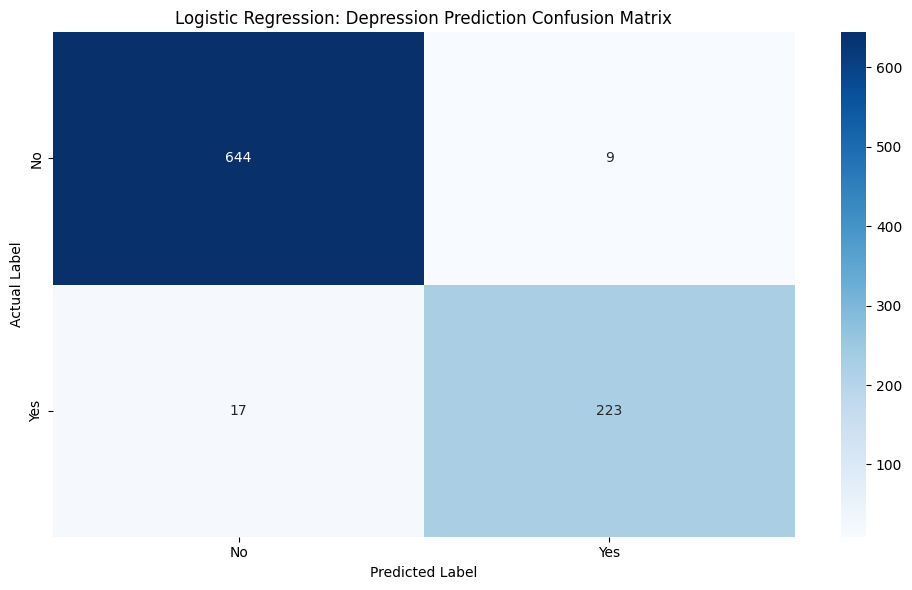
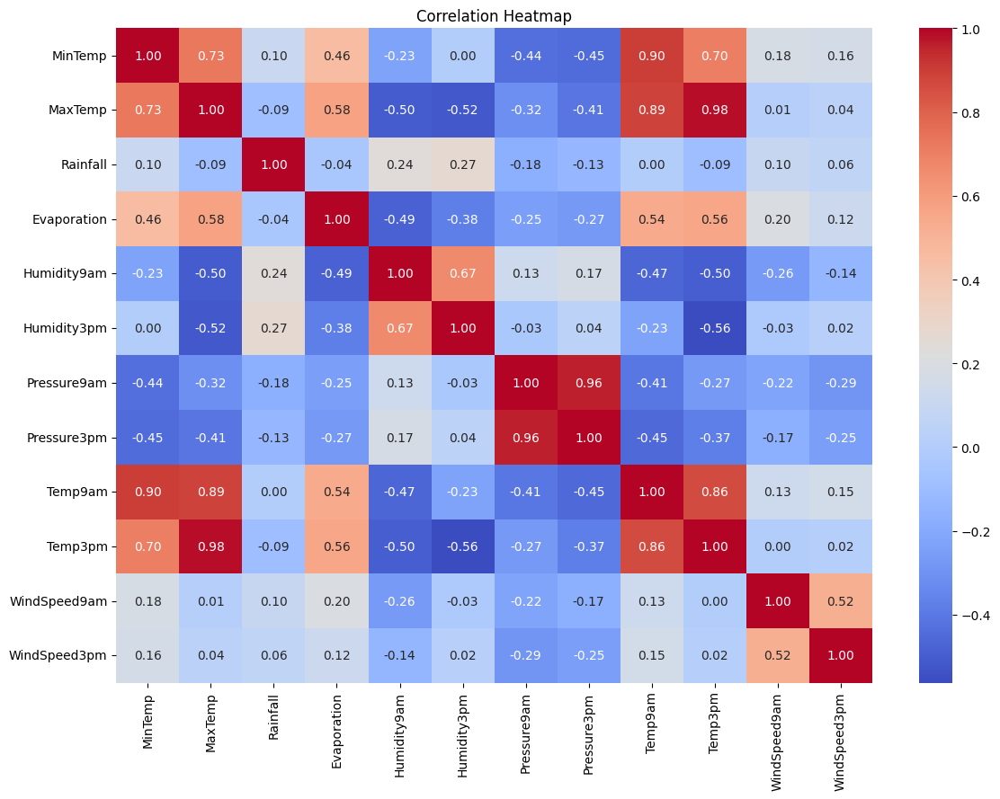
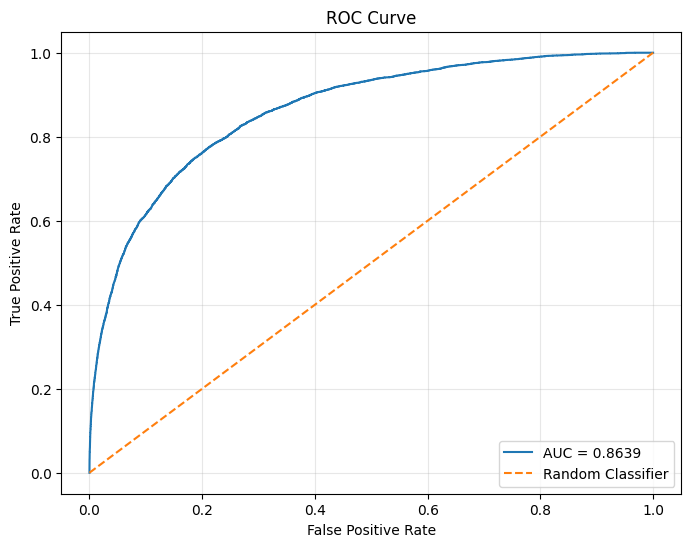
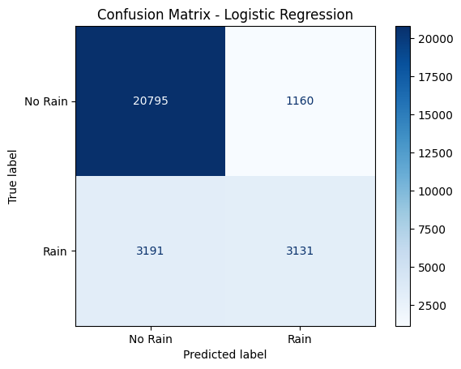

# Machine Learning & Big Data

## Objectif du TP

L'objectif de ce TP est de développer et d'évaluer deux modèles de Machine Learning en utilisant deux approches différentes :

- **Machine Learning classique :** réalisation d'un pipeline complet de traitement et d'analyse des données, comprenant l'EDA, le prétraitement, la transformation des données, l'entraînement et l'évaluation du modèle.
- **Big Data :** réalisation d'un pipeline de Machine Learning utilisant Hadoop, HDFS et PySpark pour le traitement de données à grande échelle, l'entraînement et l'évaluation du modèle.

---

# 1. Student Depression Detection

## Objectif

L'objectif est de développer un modèle de Machine Learning capable de prédire la présence de dépression chez les étudiants à partir de caractéristiques générales relatives à leur profil et à leur situation personnelle, académique et sociale.

Le problème est formulé comme une tâche de classification binaire :

- **1 :** l'étudiant présente une dépression.
- **0 :** l'étudiant ne présente pas de dépression.

## Bibliothèques

- scikit-learn
- numpy
- pandas
- matplotlib
- seaborn

## Dataset

Le dataset est téléchargé depuis Kaggle : [Student Depression Detection Dataset](https://www.kaggle.com/datasets/mkhoirulmustaqim/student-depression-detection-dataset). Il possède :

- 4464 lignes
- 13 colonnes

## Modèle

Le modèle utilisé est une régression logistique.

## Évaluation du modèle

Le modèle a obtenu les résultats suivants :

- **Accuracy :** 97.09 %

### Classification Report

| Classe | Precision | Recall | F1-score | Support |
|---|---:|---:|---:|---:|
| No | 0.97 | 0.99 | 0.98 | 653 |
| Yes | 0.96 | 0.93 | 0.94 | 240 |
| **Accuracy** | | | **0.97** | **893** |
| Macro avg | 0.97 | 0.96 | 0.96 | 893 |
| Weighted avg | 0.97 | 0.97 | 0.97 | 893 |

### Matrice de confusion

---

# 2. Big Data - Australia Rain Prediction

## Objectif

L'objectif est de développer un modèle de Machine Learning capable de prédire s'il pleuvra un jour donné, en utilisant comme variables d'entrée les données météorologiques enregistrées la veille.

Le problème est formulé comme une tâche de classification binaire :

- **1 :** il pleuvra le lendemain.
- **0 :** il ne pleuvra pas le lendemain.

## Technologies et bibliothèques

- Hadoop
- PySpark
- Python
- Scikit-learn
- Pandas
- Matplotlib
- Seaborn

## Dataset

Les données météorologiques sont stockées dans Hadoop Distributed File System (HDFS) et importées dans PySpark.

Le dataset est téléchargé depuis Kaggle : [Rain in Australia Prediction Dataset](https://www.kaggle.com/datasets/jsphyg/weather-dataset-rattle-package). Il possède :

- 145460 lignes
- 23 colonnes

### Correlation Heatmap

## Modèle

Le modèle utilisé est une régression logistique de PySpark ML.

## Évaluation du modèle

Les performances du modèle sont évaluées à l'aide des métriques suivantes :

| Métrique | Résultat |
|---|---:|
| Accuracy | 0.8461 |
| F1-score | 0.8348 |
| AUC-ROC | 0.8639 |

### Courbe ROC-AUC

### Matrice de confusion

---

# Conclusion

Ce TP permet de mettre en pratique deux approches du Machine Learning :

- Une approche classique avec un pipeline complet de préparation et d'entraînement des données.
- Une approche Big Data reposant sur Hadoop, HDFS et PySpark, permettant d'entraîner un modèle dans un environnement distribué.

Les deux approches permettent de mettre en œuvre des tâches de classification binaire et d'évaluer les performances des modèles obtenus.